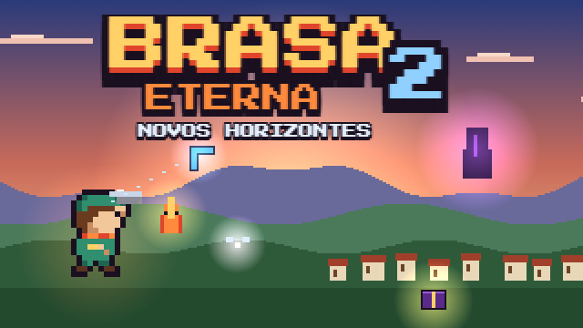

# Brasa Eterna 2: Novos Horizontes

Continuação de [Brasa Eterna](https://github.com/Hebersonmiliano/brasa-eterna): um RPG de ação em pixel art,
agora em mundo aberto. Feito em HTML/JavaScript, sem instalação: abra `index.html` no navegador e jogue.

**Jogar online:** https://hebersonmiliano.github.io/portal-jogos/jogo.html?id=brasa-eterna-2

> **Versão 1.0: história completa!** Do começo na Vila Aurora até o grande segredo de Kael, dentro da Pedra Negra.

## História

Morvane caiu e as cinco brasas voltaram a arder. Mas, no Deserto de Vidro, Kael encontrou uma
cinza negra e fria. Ele segue o rastro além das fronteiras de Valdora e chega à Vila Aurora,
onde uma pedra negra caiu do céu e diz apenas: "ainda não". Cada gigante que cai deixa uma pista,
e quando as sete vozes se juntam, a pedra vira um espelho... e a resposta está do outro lado.

## O que tem nesta versão

- **Mundo aberto** com câmera, ciclo de dia e noite, minimapa e mapa com névoa
- **Vila Aurora**: pousada (dormir salva o jogo), ferraria, mercearia, ancião e moradores com missões
- **4 masmorras**: Cisterna Antiga (pelo poço da praça), Gruta Cristalina, Covil do Lobo Alfa e Cripta Afundada
- **HP, MP e stamina**: a esquiva gasta stamina, os poderes elementais gastam MP
- **10 espaços de equipamento**: espada, arco, escudo, elmo, armadura, luvas, botas, capa, anel e colar
- **Forja até +7** com gemas, minério de ferro, cristais e joias
- **Ferramentas**: bombas, arco e flechas, gancho, bumerangue que muda de cor ao evoluir e luvas que erguem pedras
- **Baús raros brilhantes** com itens que nenhuma loja vende
- **Monstros raros** dourados, incluindo um Lobo Alfa gigante
- **Fadas** que curam todo o HP; guardadas num frasco, elas ressuscitam o Kael
- **Tenda** para acampar ao ar livre, poções de vida, éter de MP e tônico de stamina
- **4 chefes gigantes**, um em cada masmorra, cada um com sua mecânica: Serpente das Águas, Golem de Cristal (bombas racham a armadura), Fenrir (faça ele bater nas pedras) e Rei Espectro (acenda os braseiros)
- **Trilha sonora com instrumentos**: cordas, metais, piano, flauta, sinos, órgão, guitarra distorcida e bateria, com tema próprio para vila, noite, pousada, cada masmorra e cada chefe
- **Casas temáticas**: pousada, ferraria de ferro e pedra, mercearia, casa do Ancião e casa da Rosa, cada uma com fachada, placa com o nome e interior próprios
- **Farm**: os monstros das masmorras voltam a aparecer, inclusive os raros
- **103 conquistas no estilo Steam**, com ícones, barras de progresso, conquistas secretas e aviso na tela
- **3 espaços de save**, salvamento automático e "Salvar agora" nas opções
- **Fama**: missões e chefes tornam Kael conhecido; moradores dão presentes e as lojas dão descontos
- **Romance com a Maria Luiza**: amizade, flores, passeios (lagoa, jardim, floresta), anel de noivado, a super missão do Anel Eterno, o casamento e duas filhas, Helen Cristine e Mariana, num lar próprio
- **Frutas e culinária**: 7 frutas em pomares pela região, carne dos monstros, fogueiras para descansar e cozinhar, 14 receitas (do omelete ao Elixir da Chama) compradas ou ganhas em missões
- **Pescaria**: vara de pesca, 10 espécies (lago, rios, Cisterna, dia e noite) e o lendário Rei do Lago
- **Jokenpô na pousada** contra o Tico Pedrada, com apostas, sequências de vitórias e prêmios
- **Grande Biblioteca de Aurora**: 9 livros ilustrados sobre a história dos jogos 1 e 2 (a Chama Sagrada, Morvane, as crônicas de Kael, bestiário, gigantes, povos, guia da vila, a Cinza Negra e o Diário de Kael), com leitura em tela cheia e páginas que viram
- **Fortaleza da Brasa, o castelo do Kael**: a leste da vila há ruínas tomadas por monstros. Limpe-as e o Mestre Gaspar reconstrói tudo: muralhas e torres, Salão do Trono (impostos diários), Forja Real (equipamentos reais), Grande Cozinha (porção dupla), Quartel, Estábulo com carruagem, Pomar Real, Torre de Vigia e casas para novos moradores
- **Costa Coral (região 2)**, ao sul da vila: praia tropical, Porto Coral com casas de palafita, píer e farol; coco, manga, banana e maracujá; equipamentos de coral mais fortes; pesca no mar; Concha Esperta na Taverna do Polvo; 3 missões novas
- **Naufrágio do Rei Coral**: com o farol aceso, o barco da Capitã Marina leva ao navio afundado; válvulas mudam a maré e abrem caminhos; chefe gigante **Kraken, o Rei do Recife** (corte 3 tentáculos para ele subir)
- **Bosque das Brumas (região 3)**, a oeste da vila: floresta enevoada com cogumelos gigantes e vaga-lumes; Aldeia Cogumelo com 5 casas-cogumelo; mirtilo, amora, figo e jabuticaba; equipamentos das brumas; Corrida de Besouros na Taverna do Besouro; Templo das Brumas (teias que só o fogo queima, aranhas); chefe gigante **Nebla, a Mãe-Aranha**; 4 missões novas e peixes que brilham no escuro
- **Castelo vivo**: 18 obras na Fortaleza (novas: Padaria Real, Mercado Real, Taverna da Coroa com os Dados da Coroa, Mina e Oficina, 2 casas); cada morador tem profissão e o reino produz comida, ferro, cristal e gemas todo dia; a família de Kael mora no castelo e faz o reino prosperar
- **Romance simples**: trilha paralela com passos claros e coração rosa no mapa; o jogo continua depois do casamento
- **Formas da Faísca**: Lobo de Brasa (avança e morde), Coruja de Cinza (penas perfurantes, sente segredos), Tartaruga de Lava (bloqueia tiros, +defesa) e Raposa Solar (ímã de itens, mais gemas, luz), cada uma com nível até 5
- **Selva Tribal (região 4)**, ao sul do Bosque das Brumas: Aldeia Jatobá com cabanas nas árvores, açaí, cupuaçu, caju e guaraná, equipamentos da selva, Batuque na taverna, Templo das Máscaras e o chefe gigante **Lagarto da Máscara** (madeira, pedra e ouro)
- **Capítulo final: Agora Sim** 🔥 com as sete pistas dos gigantes, a Pedra Negra se abre para **O Mundo em Rascunho**, uma masmorra desenhada a lápis: Galeria dos Gigantes, Página Apagada com lápis que redesenham a ponte, Porta de Grafite e a emboscada dos rabiscos e borrachas no Salão dos Espelhos
- **Chefe final: a Cinza Negra**, em três formas: a borracha que apaga o chão (ataque quando a mão ficar presa), o Espelho de Cinza (pegue a Pena Dourada para ferir o reflexo) e o Fim Inacabado (o coração frio só sente o fogo da Chama)
- **O grande segredo de Kael**, o final com a festa em Aurora, **créditos** e o mundo aberto continua depois do fim, com a espada lendária **Pena da Chama** e a Pedra Negra agora quente
- **Jornada**: o próximo passo da história sempre na tela, até a JORNADA COMPLETA
- Bônus para quem terminou o primeiro jogo

## Controles

| Ação | Teclado | Controle | Celular |
|---|---|---|---|
| Mover (8 direções) | WASD / setas | Analógico / direcional | Direcional na tela |
| Espada, falar, erguer | J / Espaço / Z | A | A |
| Disparo elemental (MP) | segure e solte a espada | segure e solte A | segure e solte A |
| Esquiva (stamina) | K / Shift / X | B | B |
| Usar item do atalho | L / V | X | L |
| Trocar item do atalho | R | RB | R |
| Menu (abas) | I / Enter | Start / Y | M |
| Trocar elemento / próxima aba | Q | LB | E |
| Tela cheia | F | | |

## Créditos

- Ideia, história e direção: Heberson Miliano
- Programação, arte e música: Claude (Anthropic)
